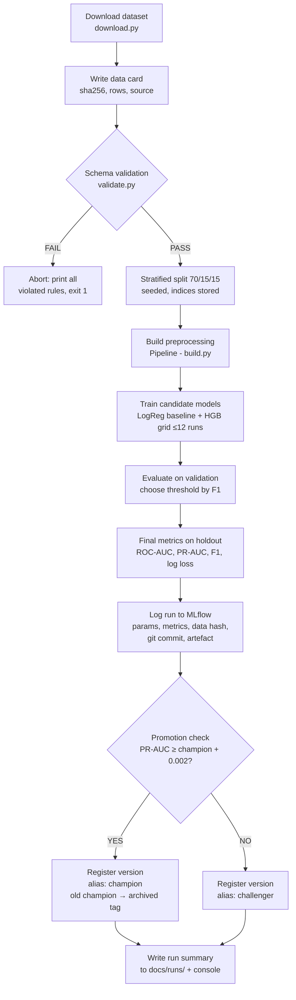
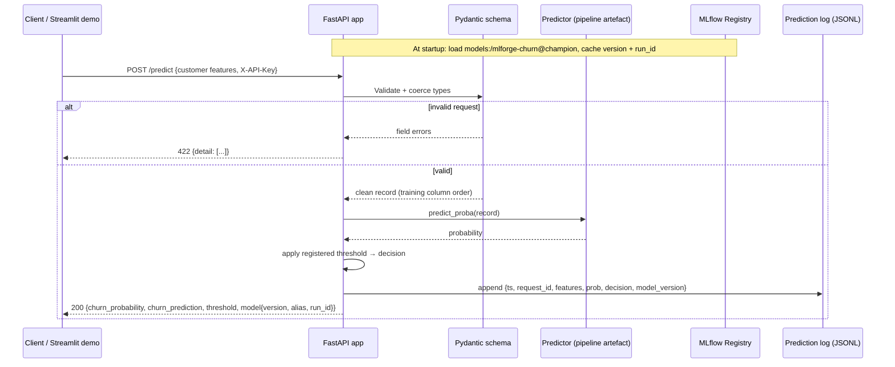
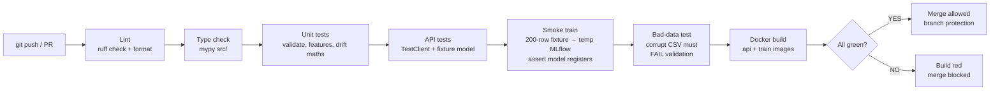
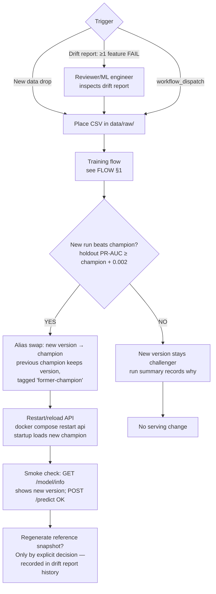

# FLOW — MLForge

Four flows. Diagrams are Mermaid (render on GitHub). "Gate" steps can stop the flow — that is by design.

## 1. Training flow

Runs via `make train` (or the training container). One pass = one MLflow run per model config.

Key properties: the holdout is touched exactly once per run (step H); the threshold is chosen on validation (step G) *before* that. Validation failure is the only hard gate before training; promotion is the only gate after it.

## 2. Inference flow

Batch (`/predict/batch`) follows the same path per row; row-level validation failures are collected into an `errors` array instead of failing the request.

## 3. CI flow

Runs on every push and pull request to `main` (GitHub Actions, `ci.yml`).

The two tests reviewers should notice: **F** proves the whole pipeline runs end-to-end on every commit, and **G** proves the validation gate actually rejects bad data (a gate that never fires in tests is decoration).

## 4. Retraining flow

Two triggers: manual (`make train` on a new data drop, or the `retrain` GitHub workflow) and drift-driven (a human decision after reading a drift report — automation proposes, the promotion rule disposes).

Two deliberate design choices:

1. **No automatic promotion.** Drift can *trigger* retraining, but a model only becomes `champion` by beating the incumbent on a held-out set. Auto-promoting on drift alone would let a shifted data drop replace a good model with an unproven one.
2. **The reference snapshot is not auto-updated.** If the drift baseline silently moved with the data, drift detection would grade its own homework. Rebaselining is an explicit, recorded decision (step J).
